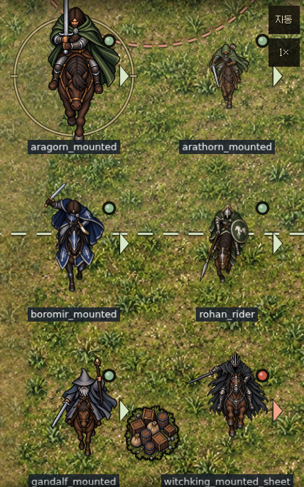
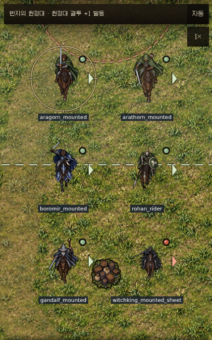
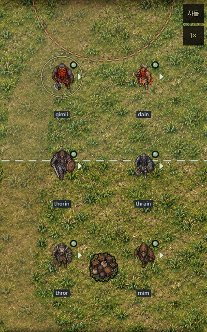
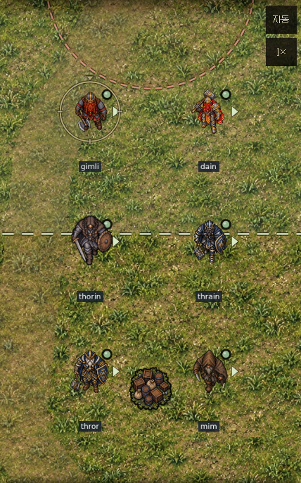
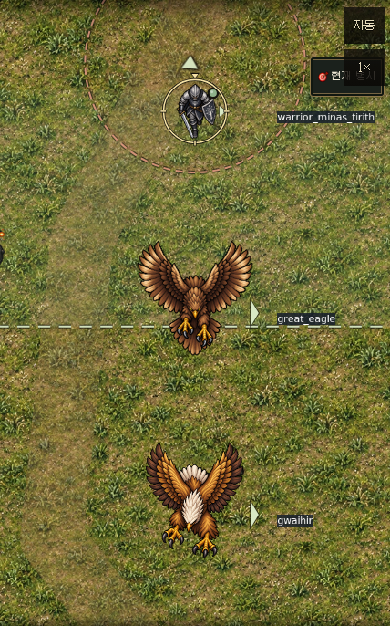
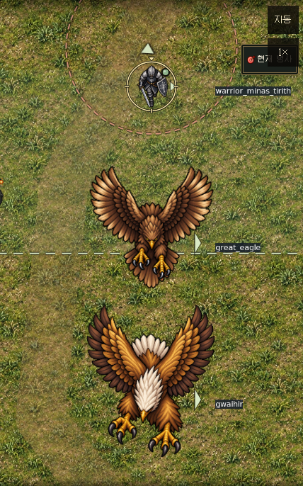
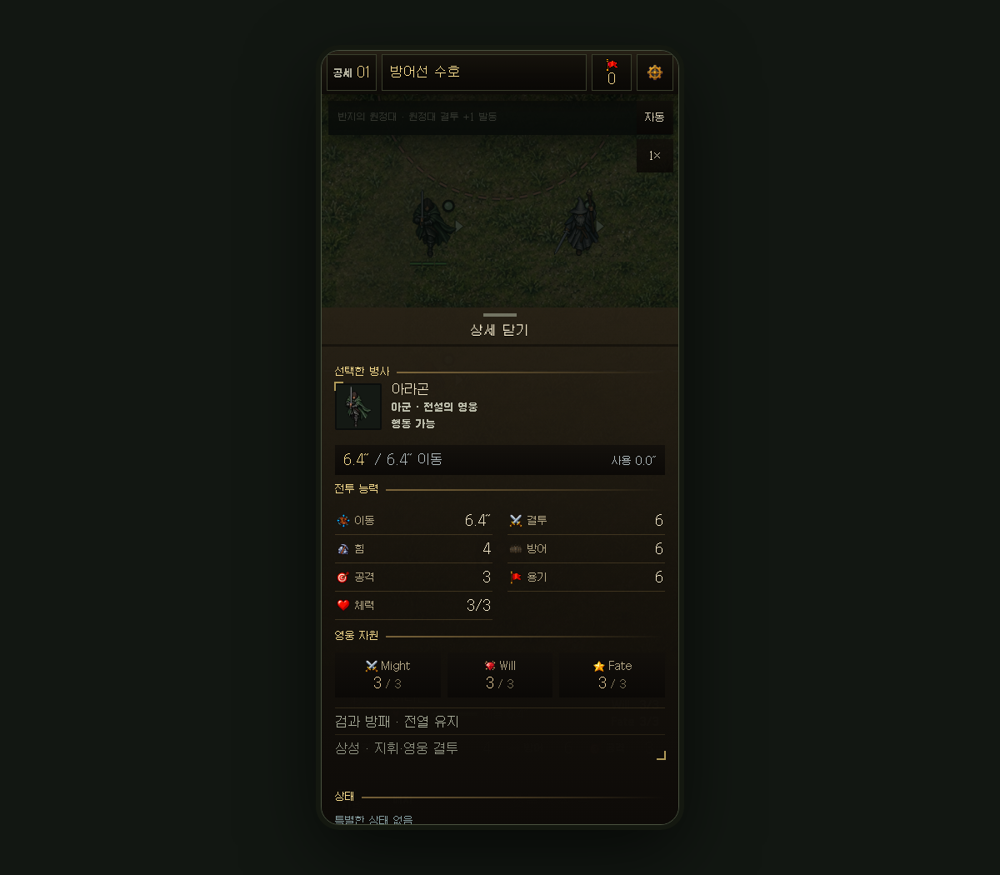

# 유닛 원판 제거·몸체 크기 통일 — Ver 1.42

전투 유닛 492종에 명시적인 몸체 기준 크기와 중심점이 있다. 진영별 원판·상시 둘레 링·바닥 타원은 제거했다. 선택·이동 범위·돌격 예고 등 전술 표시는 유지한다. 원화 PNG와 충돌 반경, 이동·전투 규칙은 바꾸지 않는다.

| 기준 | 월드 픽셀 | 측정 |
|---|---:|---|
| 인간·일반 엘프 보행 | 86 | 머리–발 몸체 |
| 호빗 보행 | 54 | 머리–발 몸체 |
| 큰 인간 보행 | 100 | 머리–발 몸체 |
| 난쟁이 보행 | 63–76 | 몸통 폭 보정 + 자세별 높이 제한 |
| 인간 기수 | 34 | 가슴·어깨 폭 |
| 큰 인간 기수 | 40 | 가슴·어깨 폭 |
| 오크 기수 | 31 | 가슴·어깨 폭 |
| 난쟁이 기수 | 41 | 가슴·어깨 폭 |

기마의 앉은 자세와 투구 장식 때문에 머리–골반 세로 길이만으로 정규화하면 크기가 크게 달라진다. 기마·난쟁이 130종은 직접 검토한 몸통 폭을 기준으로 쓰며, 무기·깃발·탈것을 측정에 포함하지 않는다. 난쟁이는 가벼운 복장과 중갑의 폭 차이를 반영하고 보행 몸체 높이는 인간보다 작게 유지한다. 기존 PNG의 가로세로 비율은 유지한다.

기수가 보이지 않는 와르그 우두머리 원화와 토끼썰매에는 기수 기준을 적용하지 않는다. 반대로 펠비스트에 타고 있는 나즈굴은 실제 기수 기준을 적용한다. 독수리는 일반 대독수리 174, 그와이히르 214, 란드로발 202, 메넬도르 180, 톨론도르 278의 몸체 높이를 쓴다. 날개 끝을 측정 기준으로 쓰지 않는다.

전체 좌표·측정 축·기준 크기·원화 치수·SHA256은 [전수 데이터](unit-art-audit.json)에 있다. Phaser 원점을 몸체 중심으로 지정하고 회전·대기·변신에도 동일한 기준을 적용한다. 알파 외곽이나 충돌 반경으로 시각 크기를 재계산하지 않는다.

## 실제 렌더 비교

같은 게임 렌더러에 유닛을 비교용으로 재배치했다. 아래 변경 전은 main `599d19a99f43f2aaa6e59771b5c33786c5203222`, 변경 후는 이 보정이다. 전체 99종의 실제 기수 원화와 난쟁이 33종을 같은 배율의 비교 화면에서 검토했다. 전수 수치 검사는 지정한 측정 구간과 렌더 크기의 일치 검사이며, 원화의 모든 미술적 비례가 동일하다는 보장은 아니다.

| 비교 | 변경 전 | 변경 후 |
|---|---|---|
| 기마 |  |  |
| 난쟁이 |  |  |
| 독수리 |  |  |

캐릭터 창의 진화 조건·진행률·다음 형태는 제거했다. 실제 100킬 진화, 자원·장비·부상 유지 및 저장·복원 동작은 유지한다.

## 검증과 갱신

- 빌드 시 내장 스크립트 구문 검사.
- 크기·원점·로딩/변신·원판 제거 회귀 검사. 아라고른/아라소른 기마, 마술왕 원화 두 버전, 회색/백색 간달프 기마의 크기 차이 재발 방지 검사.
- 전투·기마 돌격·지원·이동·원정 인벤토리·지형 회귀 검사.
- 영웅 293개 프로필 양 진영 실행(586회), 5종의 99→100킬 진화 경로 확인.
- 실제 브라우저 492/492 렌더 구간·중심점·텍스처 검사, JavaScript 오류 0. 캐릭터 창의 99킬 상태에서 숨김 확인. [브라우저 기록](unit-art-recheck/browser-report.json).

원화가 바뀌면 해당 좌표를 눈으로 다시 검토한다. `node tools/sync-unit-art-profiles.cjs` → `node tools/build.js --online-only` → 테스트 → 실제 비교 화면 검토 순서를 따른다. 최초 원판 제거의 비교 캡처와 일반 자동 전투 검증은 `unit-art-proof/`에 남아 있다.
