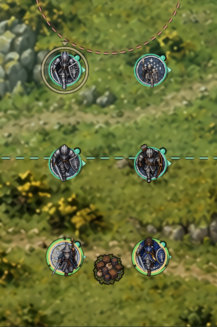
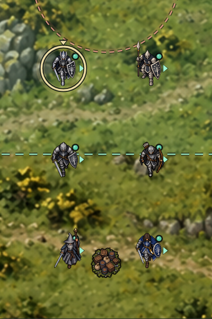
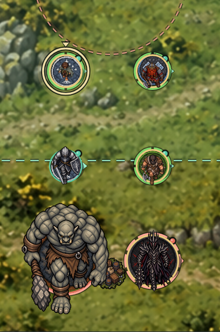
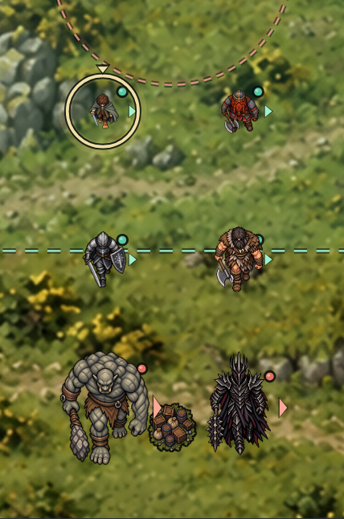
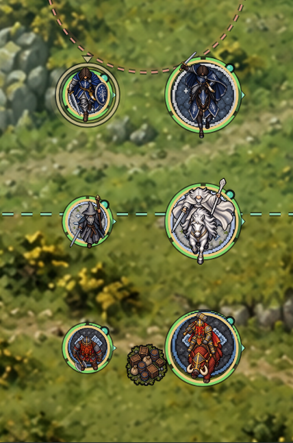
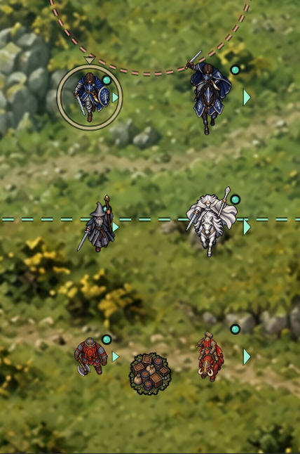
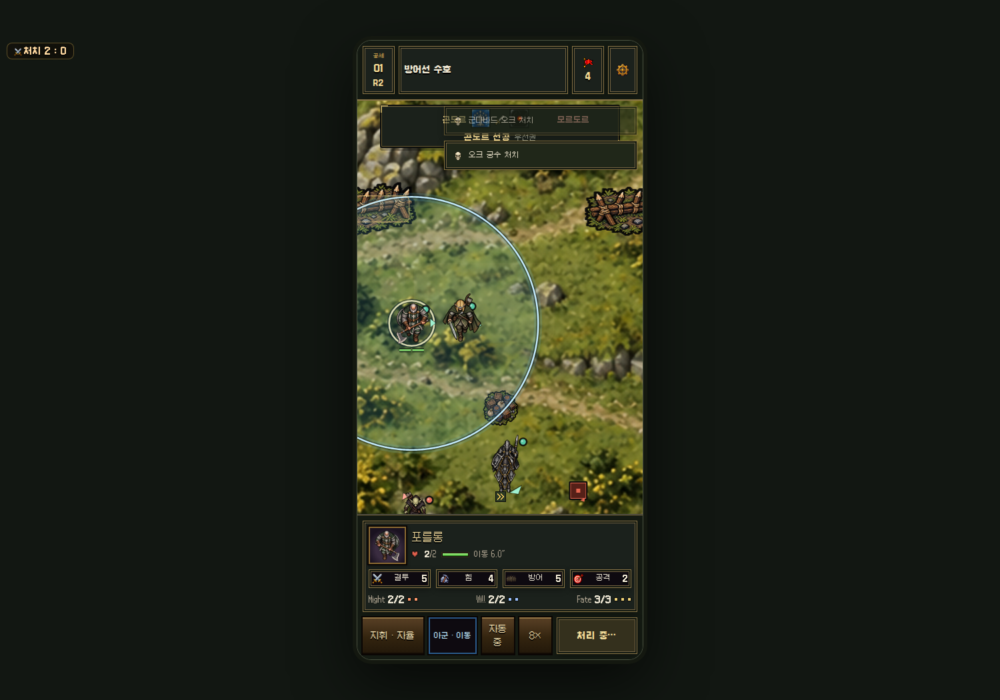

# 유닛 원판 제거·몸체 크기 통일

기준 main: `a1a254cf6c3a1e0e91f6cc4a82208a62a6bf5ef3`.
작업 브랜치: `fix/body-scale-no-bases-20261013`.

전투 유닛 492종의 원화를 대조하고, 장식물이 아닌 몸체 크기·중심점을 지정했다. 183종은 자동 초안의 무기·깃발·날개 등에 치우친 좌표를 교정했고, 기마 원화 101종은 기수 골반/안장 위치를 별도로 지정했다. 게임 규칙상 보행인 `azog`도 실제 원화가 와르그 탑승이므로 시각 크기는 기수 기준을 사용한다.

| 몸체 체급 | 인간 대비 | 기준 높이(월드 픽셀) |
|---|---:|---:|
| 호빗 | 0.63 | 54 |
| 난쟁이 | 0.78 | 67 |
| 인간·일반 엘프 | 1.00 | 86 |
| 큰 인간·대형 우루크 | 1.16 | 100 |
| 고블린 | 0.73 | 63 |
| 오크 | 0.91 | 78 |
| 트롤 | 2.02 | 174 |
| 엔트 | 2.49 | 214 |

괴수는 트롤·엔트·큰 늑대·독수리·펠비스트·드래곤·무마킬 등의 체급을 따로 사용한다. 독수리 날개, 드래곤 날개·꼬리, 창, 깃발은 기준 높이에 포함하지 않는다. 기마는 기수의 머리–골반 길이를 해당 종족 보행 높이의 56%로 맞춘다. 몸체와 기수의 좌표·원화 치수·SHA256은 [전수 데이터](unit-art-audit.json)에 기록했다.

진영별 원판과 상시 둘레 링·바닥 타원을 제거했다. 다상처 유닛의 원형 체력판은 부상 또는 선택 시 나타나는 작은 분할 막대로 교체했다. 선택·이동 범위·돌격/교전 예고는 기존 전술 표시를 유지한다.

Phaser 이미지 원점을 몸체 중심으로 지정하므로 회전·대기 애니메이션도 몸체를 중심으로 움직인다. 알파 외곽 분석과 충돌 반경 기반 표시 크기 계산은 제거했다. 원화 PNG, 썸네일, 충돌 반경, 이동·공격·스킬·저장 규칙은 수정하지 않았다.

## 실제 렌더 비교

아래 비교는 원래 게임의 Phaser 전장 렌더러에 같은 유닛을 검증용으로 재배치한 캡처다. 일반 UI로 영입·배치·자동 전투도 별도로 확인했다. 전수 기계 검증은 렌더 좌표·기준 크기의 일치 검사이며 모든 유닛의 모든 전투 조합을 플레이했다는 뜻은 아니다.

| 비교 | 변경 전 | 변경 후 |
|---|---|---|
| 인간·장창·마법사 |  |  |
| 종족·괴수 체급 |  |  |
| 보행·기수 기준 |  |  |

## 검증

- `node tools/build.js --online-only`: 모든 내장 스크립트 구문 검사 통과.
- `node tests/unit-art.test.cjs`: 492종 완전성, 체급·중심, 로딩/변신 갱신, 원판/외곽 분석 제거 검사 5개 통과.
- `node --test tests/unit-art.test.cjs tests/tactics.test.cjs`: 25개 통과. 충돌 크기·지원·기마 돌격·이동·스테이지·야영지 검사 포함.
- 영웅 개성/진화 검사: 293개 영웅 프로필 양 진영 실행(586회), 5종의 99→100킬 진화 경로 통과.
- 원정 인벤토리 회귀 검사: 9개 통과.
- 실제 브라우저: 492/492 텍스처·기준 크기·몸체 중심 검사 통과, JavaScript 오류 0. 일반 자동 전투 3라운드에서 이동 3기와 전투 진행 확인. [브라우저 기록](unit-art-proof/browser-report.json).

원화가 교체되면 크기·중심점도 다시 검토해야 한다. `EDITING.md`의 몸체 기준 절차와 `tools/sync-unit-art-profiles.cjs`를 사용한다. main 병합·배포는 수행하지 않았다.
