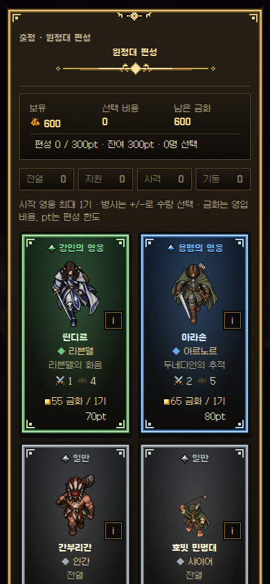
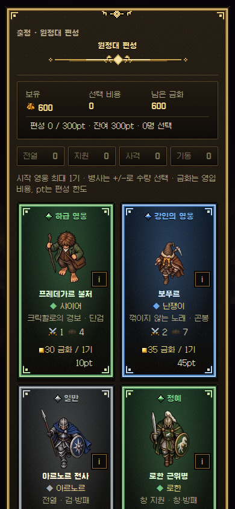
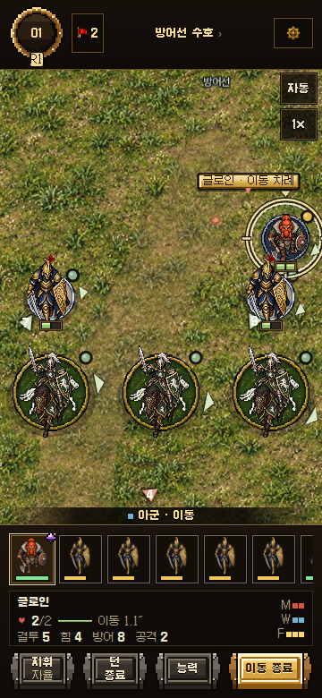
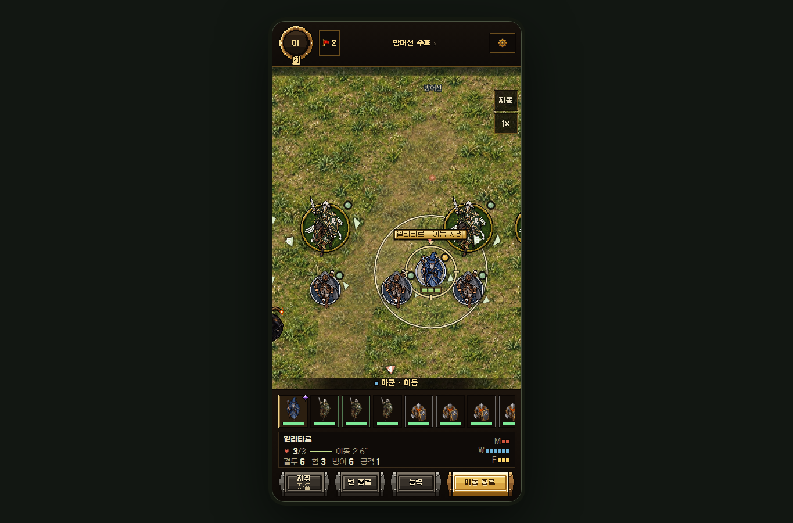
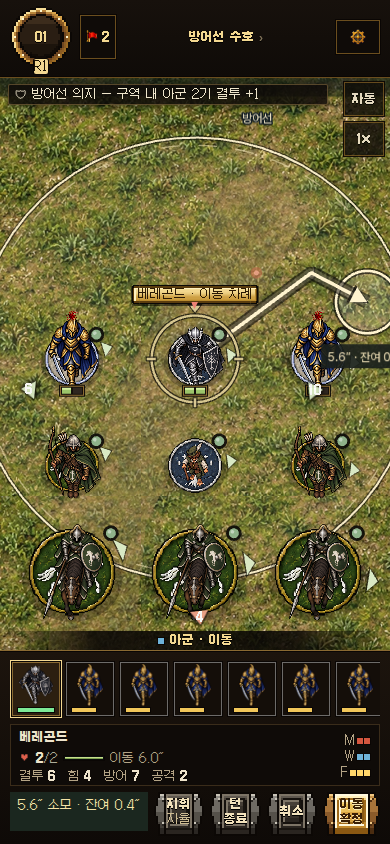
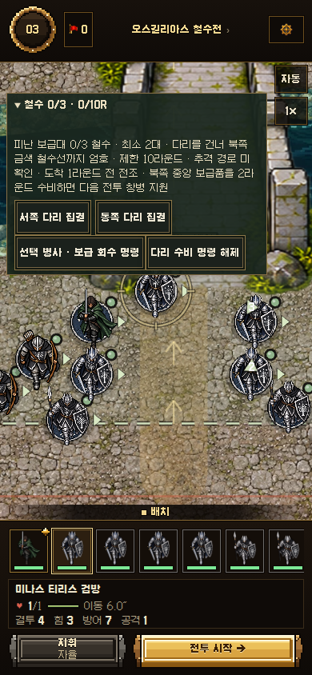
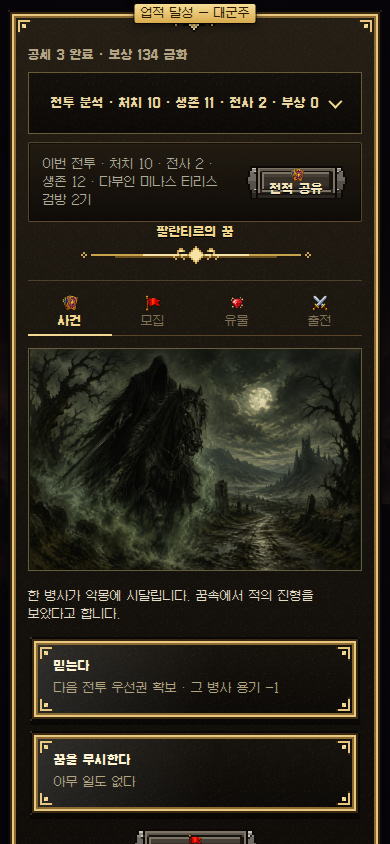
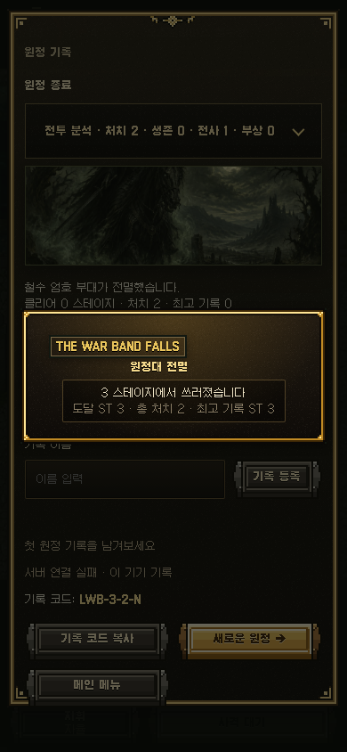
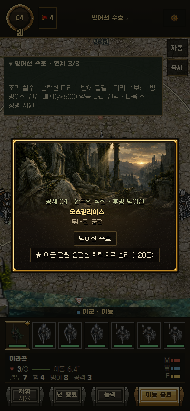
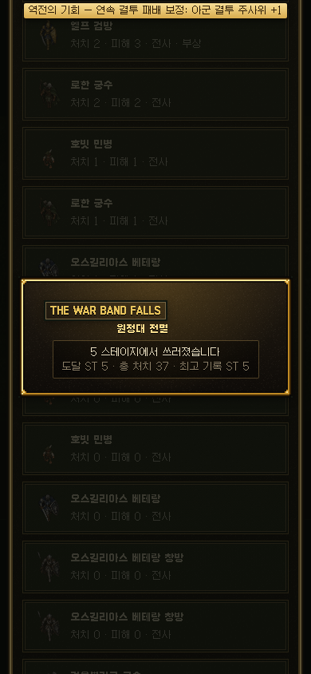

# 실플레이 QA 개선 결과

기준 저장소: `leesh603/mesbg-assets`  
기준 main: `e804344617e860324a09ea9c33264fa201783ae0`  
작업 브랜치: `feat/playtest-overhaul-20261015`  
원본 QA: `audit/playtest-20261015-e804344/reports/audit-20261015/` (수정하지 않음)

이 보고서에서 실제 Chromium 조작, 브라우저에 올린 시작 시나리오, Node 엔진 시뮬레이션을 구분한다. 실제 Android/iOS 기기 검사는 수행하지 않았다. main 병합·라이브 배포는 수행하지 않았다.

## 확정 버그와 재현

| 항목 | 수정 전 재현 | 원인과 수정 | 검증 |
|---|---|---|---|
| BUG-01 유료 사건 무료 사용 | 0금화로 피난민 선택 시 용기 6→7 | 효과 내부의 차감·잔액 보정을 없애고 28개 선택지에 비용 선언. 공통 비용 검사와 원자적 실행·저장·롤백 적용 | 각 선택지 잔액 0/비용−1/비용/비용+1, 15금화의 0/14/15/16, 재선택 거절, 효과·저장 실패 롤백 |
| BUG-02 피해가 회복 | 습격 선택 시 체력 1→2 | 잘못된 피해 사건 5개 수정. 피해 사건 9개를 실제 피해/사망/유품 처리 경로로 통일. 비치명적 사건은 체력 최소 1을 명시 | 피해 선택지 9개, 회복 선택지 16개, 비치명적 최소 체력, 치명 피해·전사 기록·유품 |
| BUG-03 무부상 목표 판정 | 전투 후 다리 부상이 생기는데 +25 지급 | 전투 종료 상태 기록 → 부상 → 목표 평가 → 보상 원장 → 결과 표시 → 저장. 완전 체력 목표는 전투 종료 순간 체력으로 판정 | `shield_wall` 실패·보상 미지급, 렘바스 사후 회복이 무피해 목표를 성공으로 바꾸지 않음 |
| BUG-04 금화/합계 불일치 | QA 지급 134/표시 109; 별도 재현 151/126, 연승 25 누락 | 첫 처치·보스·엘리트·전설 전리품·상자·유물·목표·기본 보상·연승·사건 수입을 영수증이 있는 원장으로 기록. 구매 지출도 별도 표시 | 실제 지급/원장/결과 합계 일치, 동일 전투 정산·동일 처치 객체 재실행·저장 재개 시 중복 차단 |
| BUG-05 잠긴 초기 모집 | 1,000회에서 잠긴 병사 후보 652개 | 초기/일반 모집/재추첨/선택/확정/직접 영입이 같은 해금 조건 사용. 무작위 선택 전에 필터링 | 초기 1,000회 6,000후보 중 잠긴 후보 0, 일반 모집 100회, 조작된 직접 영입 차단 |
| BUG-06 역할 오표기 | 궁병·레인저도 능력란에 `전열` | 전투에서 쓰는 사거리·창 지원·기마·지휘 분류를 카드와 프로필에 재사용. 무장·사거리·포인트 병기 | 보병/창병/궁병/레인저/기병/지원병 분류 검사, 세 해상도 실제 카드 캡처 |

추가로 발견해 수정한 사항:

- 골룸·미스릴 광맥·아르고나스 사건 ID 중복 3건. 후반 사건만 새 ID를 부여하고, 예전 저장은 제목·선택지로 원래 의미를 찾아 복원한다.
- 비용이 없거나 자체 검사만 하던 대상단·시장·양조장 등 유료 선택지도 공통 처리한다. 치료·상점 재진열·장비·탈것·승급·모집 구매는 저장 실패 시 자원과 효과를 함께 되돌린다.
- 엘프 치유 사건의 부상 표시만 제거되고 능력치가 복구되지 않는 문제, 고장 난 마차 사건의 부상이 실제 이동력에 반영되지 않는 문제를 수정한다.
- 1인치/2인치 이동 버프 단위와 안내 불일치, 부품 회수가 유물 획득으로 안내되는 문구를 수정한다.
- 사망 시 일반 병사 장비도 실제 유품으로 남긴다. 유품으로 이전된 장비는 시신에서 제거해 부활 복제를 막는다. 부활 후 다시 전사하면 새 전사로 집계한다.
- 설정 창을 여는 동안 AI 진행을 멈추고, 단계가 바뀌어도 설정 창을 임의로 닫지 않는다.

## 실제 게임 변경

### 전술과 예측

기존의 방패벽, 창/장창 지원, 결투, 용기, 사선, 기병 전도, 영웅적 행동, 지형 충돌 계산을 유지한다. 행동 예측은 실제 이동 `ve`, 돌격 `chargePlan`, 사격 `validTargets`, 능력 `skillReason`를 사용한다. 이동력 소모·잔여, 얕은 물의 50% 이동, 다리 경로, 지원병, 공포 검사, 사격 불가 이유를 확인할 수 있다.

디지털 전장 추가 규칙으로 다리·험지 돌격에는 기병 추가 주사위/전도를 주지 않으며, 전열 유지 중 창 지원을 받는 보병도 돌격 보너스를 막는다. 이 부분은 공식 MESBG 규칙의 완전한 복제라고 주장하지 않는다. 판정과 예측은 같은 `chargeBonus`를 사용한다.

자동전투는 유지한다. 영웅의 구체적인 치명 위험, 임무 실패 위험, 중요한 선택에서 선택적으로 정지한다. 설정의 세 항목을 끌 수 있다. 일반 이동마다 중단하지 않는다. 전투 종료·패배·재개에서는 이 선택 설정과 관계없이 자동 진행을 해제해 배치·야영지·승급 선택이 자동 실행과 경합하지 않게 한다.

실플레이에서 소굴 소탕전의 자동전투가 증원 병력만 추격하는 문제를 발견했다. AI에 소굴 우선 공격·사격, 정찰품 수집, 거점 수비, 호송대/철수대 엄호를 연결했다. 플레이어의 전열 유지·집중 공격 명령은 임무 AI보다 우선한다. 모든 이동은 실제 경로와 이동력을 사용한다.

### 병사 육성

- 처치·참전·생존 경험치는 유지한다.
- 창/결투 지원, 다리 방어선 유지, 임무 수비, 실제 정찰 정보 수집, 호송 보호, 영웅 주변 교전에 전공을 기록한다.
- 행동 영수증과 전투별 상한을 사용한다. 전공 경험치는 한 전투 최대 18이며, 같은 지원/거점 행동을 반복해서 무한히 획득할 수 없다.
- 생존 전투 수, 전공, 지원, 처치, 승급 이력, 부상 이력과 별칭을 보존한다. 별칭에는 추가 능력치가 없다.
- 기존 분기형 승급 데이터를 재사용한다. 최초 영입 포인트, UID, 영구 보너스, 장비, 경험치, 낙마/재승마 이력을 유지한다.
- 고유 능력 무료 발동, Might를 쓰는 영웅적 행동/주사위 수정, 개인 100킬 숨겨진 진화를 유지한다.
- 새로운 유닛·임시 그림·스프라이트 크기/정렬 변경은 없다.

추가 통합 QA에서 오래된 전사자를 부활시킬 때 경험치·승급·생존 이력이 사라지던 문제를 수정했다. 전사 기록에 상태를 보관하고 원래 UID로 복원하며, 유품 장비는 복제하지 않는다. `revive-before.json`, `revive-after.json`과 회귀 검사가 근거다.

신규 개발 중 정찰 성공 후 적 편성 미리보기를 그리다가 멈추는 오류도 발견했다. 존재하지 않는 `orc_spear`를 실제 `orc_spearman`으로 교정하고, 모든 연계 편성/추격대의 카탈로그 참조를 검사한다.

## 안두인 연계 작전

### 진입과 진행

1. 다음 공세가 2/7/12/…인 출전 준비 야영지에 `연계 작전 선택 · 3전투`가 나타난다. 주간 도전에서는 제시하지 않는다.
2. 선택하면 `정찰전 → 오스길리아스 철수전 → 후방 방어전`을 연속 진행한다. 각 전투 사이에 기존 야영지·모집·유물·승급·저장을 이용한다.
3. 기존 보스 공세 직전까지 끝나며, 종료 후 일반 무작위 원정으로 복귀한다. 작전을 선택하지 않으면 일반 경로를 이용한다.
4. 작전 중 임의의 일반 경로로 빠지는 버튼은 잠근다. 완료 후 다시 제안하기까지 대기 구간을 둔다.

### 철수전 승패와 선택

병사를 선택하고 전장 왼쪽의 임무 안내를 펼치면 `보급 회수 명령`과 `다리 수비 명령`을 지정할 수 있다. 기병은 회수·우회에, 도보 병사는 다리 북측 통로를 비운 수비에 적합하다. 이 지시는 자동전투의 이동 우선순위이며 CP/Might를 소모하지 않고 정상 이동력을 쓴다. 직접 이동할 수도 있다. 회수는 지점에서 적의 방해 없이 2라운드 수비해야 하며, 다리 수비도 실제 위치와 적 접근 여부를 판정한다.


- 기존 오스길리아스 강과 두 석교, 기존 보급 마차 그림을 사용한다.
- 피난 보급대 3대가 남쪽에서 북쪽 후방 `y≤260`으로 이동한다. 실제 충돌·지형 경로를 따라 라운드 종료 시 이동하며, 교전 중에는 움직이지 않는다.
- 최소 2대가 필요하다. 3대 철수 시 즉시 성공. 2대 철수 후 `지금 철수`로 조기 종료할 수 있다. 10라운드 제한에서도 최소 2대가 나갔다면 성공한다.
- 2대 철수가 불가능할 만큼 보급대를 잃거나, 제한 시간에 2대를 철수시키지 못하거나, 엄호 부대가 전멸하면 패배한다. 적 전멸만으로 임무가 끝나지 않는다.
- R3 동쪽/R6 서쪽 추격대에 전조를 준다. 정찰 성공 시 이 경로를 미리 공개하고 우선권을 확보한다.
- 보급품 지점 `(1150,520)`을 2라운드 지키면 다음 방어전에 실제 창병 1명이 합류한다.
- 다리 북측을 2라운드 확보하면 다음 방어전의 전진 배치 범위와 양쪽 다리 집결 선택을 연다.
- 전원 철수와 보급품 회수는 별도 원장 보상이다. 조기 철수는 병력 생존을 우선하는 다른 결과로 기록한다.

## 검증과 증거

`tests/playtest-overhaul.test.cjs`: 확정 버그, 비용/저장 롤백, 상태·포인트, 전공, 철수 승패·조기 종료, 연계 효과를 검사한다.

기존 검사:

- 영웅 고유 능력·영웅적 행동 분리, 293개 영웅 프로필 양 진영 586회, 5개 형태의 99→100킬 진화.
- 모든 승급 경로, 장비/영구 수치/부상 이력, 낙마·재승마 시 최초 포인트.
- 저장/슬롯/이어하기·잘못된 데이터 거절·할당량 오류·재도전/후퇴의 상태 복원.
- 지형 단위 검사: 깊은 강 불가, 얕은 강 이동력 2배 소모, 다리 외 수면 불가, 사선 차단.
- 27개 지역의 보병/기병/호송대/소굴 배치. 오스길리아스·모리아·팡고른·어둠숲에서 실제 엔진 AI로 전투 종료 확인.

브라우저 검사 실행과 결과는 `browser/report.json` 및 PNG를 근거로 작성한다. GitHub 작업의 종료 코드만 보고 성공으로 판단하지 않는다. UI 조작은 Chromium의 실제 버튼/전장 입력으로 진행하며, 초기 시나리오 주입과 자연스러운 연속 원정을 구분한다.

## 최종 실제 브라우저 결과

게임 코드 검증 SHA: `afac537a9df5f826e51cfdcdabd0e34c9abc70a0`. [전체 Chromium 실행](https://github.com/leesh603/mesbg-assets/actions/runs/38681811571). 원시 기록은 `browser/report.json`에 보존했다.

마우스로 조작한 Chromium 뷰포트 검사다. 360×780·390×844·1365×900에서 모집과 전장 이동의 미리보기·취소·확정을 실행했다. 390×844에서 새 원정 시작, 야영·유물·승급·저장·재개를 거쳐 5공세를 연속 플레이했다. 다섯 전투를 모두 이긴 검사로 보고하지 않는다.

| 공세 | 임무 | 실제 결과 | 라운드 | 처치/생존/전사/부상 | 시작 금화 → 획득 → 결과 금화 |
|---|---|---|---:|---|---|
| 1 | 방어전 | 승리 | 6 | 7/22/1/6 | 70 → +121 → 191 |
| 2 | 정찰전 | 승리 | 4 | 3/20/0/6 | 191 → +119 → 310 |
| 3 | 오스길리아스 철수전 | 승리 | 10 | 8/17/3/4 | 270 → +89 → 359 |
| 4 | 방어전 | 승리 | 24 | 9/9/6/2 | 269 → +183 → 452 |
| 5 | 모리아 보스전 | 패배 | 11 | 생존 0 · 상세 화면 첨부 | 기본 승리 보상 없음 |

연계 작전은 1공세 후 실제 버튼으로 선택했다. 정찰 성공 → 다음 추격 경로 공개 → 보급대 2대 철수 → 기본 배치로 후방 방어 → 작전 종료와 일반 원정 복귀를 확인했다. 병사 2명이 `elf_swordshield`로 승급했고 유물 4종을 선택했다. 전투 기록에는 실제 창 지원 12회와 전공 경험치 100이 남았다. 지원/전공에는 전투별 상한이 있으며, 처치·참전·생존 경험치는 별도다.

| 별도 철수 시나리오 | 결과 | 실제 후속 효과 |
|---|---|---|
| 혼합 13인 엄호 부대(298pt) | 8라운드, 2대 철수 후 UI로 조기 철수 성공 | 기병 회수 지시·보병 다리 수비 지시 → 실제 회수·확보 → 방어전 4공세 출전 후 창병 1명 합류, 전진 배치 y≤600 |
| 보병 1인 엄호 부대 | 6라운드, 철수 0대·엄호 부대 전멸로 패배 | 원정 패배 화면 |

이 두 시나리오는 합법적인 병종·포인트 범위의 시작 편성을 저장 형태로 제공했다. 결과·체력·적 처치·승패를 강제로 변경하지 않았다. `gondor_archer`는 기존 저장 호환용 궁병 별칭이며 일반 신규 모집에서는 정규 ID를 사용한다.

| 검증 항목 | 판정 | 실행 범위 |
|---|---|---|
| 초기 모집 1,000회 | 통과 | 6,000 후보 중 해금 위반 0 |
| 유료 선택지 28개·잔액 경계·롤백 | 통과 | Node 실제 실행, 15금화의 0/14/15/16 포함 |
| 피해 9개·회복 16개·사건 전수 334건 | 통과 | 실제 효과·체력·재화 검사 |
| 사후 부상·목표·보상 순서 | 통과 | 회귀 테스트, 실제 1~4공세 원장 대조 |
| 실제 금화/원장/표시 합계 | 통과 | 실제 1~4공세 모두 일치 |
| 저장·재개 상태 | 통과 | 브라우저 금화·UID·병종·체력·좌표·최초 포인트 완전 일치 |
| 역할별 이동·지원·사격·돌격 | 통과 | 엔진 규칙 검사, 혼합 부대의 실제 자동 전투와 세 해상도 수동 이동 |
| 깊은 강/얕은 강/다리 | 통과 | 지형 검사·실제 철수대 도하 |
| 승급·낙마·재승마·오래된 전사자 부활 | 통과 | 최초 포인트·성장·UID·유품 중복 회귀 검사 |
| 수동/자동 전환·야영 경계 | 통과 | UI 전환, 경계에서 자동 해제, 실제 승급 2명 |
| 철수전 성공·패배 | 통과 | 별도 실제 브라우저 시나리오 |
| 연계 전투·전진 배치·실제 지원병·일반 복귀 | 통과 | 2~4공세 실제 진행 + 별도 회수/수비 지시의 후속 출전에서 창병 1명 확인 |
| 5공세 연속 플레이 | 통과 | 4승 1패; 5승으로 주장하지 않음 |
| 예외·UI 멈춤·HTTP 로딩 오류 | 통과 | pageerror 0, console.error 0, HTTP 4xx/5xx 0, 가로 넘침/깨진 표시 이미지 0 |
| 음원 요청 취소 | 미검증 | `heroes-bosses.opus` ERR_ABORTED 4건 기록. 취소 원인·재생 누락 여부는 별도 추적하지 않음 |
| 실제 Android/iOS·멀티터치·장시간 메모리 | 미검증 | 접근 가능한 실기기 없음 |

처치/전사 숫자는 병사와 임무용 보급대를 구분한다. 패배한 전투의 결과 화면은 보존했으며, 5공세의 세부 보상 원장 검사는 승리 정산 검사에 포함하지 않았다.

## 화면 캡처

| 수정 전 390×844 모집 | 수정 후 390×844 모집 |
|---|---|
|  |  |










## 브라우저 성능 측정

| 해상도 | 장면 준비 전→후 | HTML DOMContentLoaded 전→후 | 메뉴 FPS 전→후 |
|---|---|---|---|
| 360 | 5.49s → 2.05s | 1026ms → 466ms | 59.3 → 57.2 |
| 390 | 2.04s → 1.99s | 449ms → 449ms | 56.5 → 56.5 |
| 1365 | 1.94s → 2.14s | 441ms → 461ms | 56.5 → 55.8 |

같은 CI 서버의 순차 실행·공유 에셋 캐시를 이용한 단일 관측이다. 첫 360 기준 실행은 캐시가 차갑고 이후 실행은 따뜻하므로, 위 차이를 성능 향상으로 주장하지 않는다. 보고된 JS 힙은 Chrome의 거친 추정치 약 42.6MiB로, 피크·누수 검사가 아니다. `browser-performance.json`에 원시 수치를 남겼다.

4공세 방어전이 24라운드까지 늘어졌고 5공세 자동전투는 패배했다. 병목에서의 전투 마무리와 다양한 편성의 보스 난도는 추가 균형 조정 대상이다. 자동 정지 설정을 모두 끈 QA 결과이므로, 기본 설정의 위험 정지나 플레이어 전술 개입에 따른 승률 향상을 실증했다고 주장하지 않는다.


## 추가 검증과 재현 방법

- `regression-tests.txt`: 새 회귀 60개를 포함한 109개 검사. 유료 사건의 15금화 경계는 0·14·15·16을 명시적으로 검사한다.
- `all-events-audit.json`: 83개 사건의 167개 선택지를 난수 0.05/0.95로 각각 실행한 334건. 예외·음수 재화·생존 유닛의 잘못된 체력 범위 0건. `node reports/playtest-overhaul-20261015/audit-all-events.cjs`로 재현한다. 이 두 난수가 가능한 모든 무작위 조합을 전수 증명한다는 뜻은 아니다.
- `hero-tests.txt`: 293개 프로필 양 진영 586회, 534회 추가 능력 발동, 5개 99→100킬 진화 경로.
- `integration-tests.txt`: 효과 대상/장비/전투 불능/구매 지원/부상 등 통합 시나리오.
- `additional-tests.txt`: 진행·호송 인벤토리·보스 패턴 26개.
- `terrain-tests.txt`: 27개 지형의 편성 배치와 오스길리아스·모리아·팡고른·어둠숲 엔진 전투. 각각 12/8/8/6라운드에 승리, 생존 3/5/4/6기.
- `supply-check.json`: 최종 브라우저에서 실제 회수 지시를 실행하고, 회수 성공과 다음 전투 지원병 1명을 확인한 증거 요약.
- `retreat-engine-paths.jsonl`: 중간 개발 단계의 엔진 진단 기록. 최종 배치 구역·통로 수정 이전 자료이므로 최종 성공 판정에는 사용하지 않는다.
- `troop-tests.txt`: 병종 승급 검사 15개 통과. PNG 원본 검사 1개는 희소 체크아웃에 원본 PNG가 없어 실행 실패(ENOENT). 승급 계산 실패와 구분한다. 기존 아트는 변경하지 않았으며 브라우저에서는 원본 main 에셋을 불러온다.

전체 저장소의 에셋·음원·원본 이미지 관련 검사를 전부 통과했다고 주장하지 않는다. 기존 `tactics.test.cjs`의 파일 존재/로컬 `origin/main` 비교 검사는 이 희소 환경에서 완료하지 못했다. 원본 main 파일을 직접 대조한 `asset-preservation.json`에서는 첫 에셋 블록이 바이트 단위로 같고, 포함된 스크립트 3개가 모두 파싱됐다. 전투 규칙 검사는 별도 실행했다.

검사 실행:

```sh
node tools/build.js --online-only
node --test tests/playtest-overhaul.test.cjs tests/free-hero-activation.test.cjs tests/qa-state.test.cjs tests/warband-points.test.cjs tests/terrain.test.cjs
node tests/playtest-browser.cjs
```

브라우저 검사는 Node 22와 Playwright Chromium이 필요하다. `.github/workflows/playtest-overhaul.yml`이 동일한 환경을 구성한다. 배포 없이 localhost에서 브랜치 코드를 제공하고, 외부 저장·순위 제출 요청을 차단한다. 실제 사용자의 저장 데이터를 변경하지 않는다. 게임을 수동 검토하려면 전체 저장소의 작업 브랜치를 체크아웃하고 `node tools/build.js --online-only`, `python3 -m http.server 8000` 후 `http://localhost:8000`에 접속한다.

추가 실제 출전 검증에서 지원병이 배치되지 않는 문제를 발견했다. 지역 스냅 함수는 반경 인자와 관계없이 최대 118만 찾고 있었다. 중앙 밀집 시 지원병과 일부 병사의 배치가 실패했다. 허용 구역 전체를 검사하고, 자동 배치에서 보급대 생성 통로를 비우도록 수정했다. 20인 부대와 지원병의 충돌·배치 검사도 추가했다.

## 성능과 남은 범위

지형 회전 캐시 후보를 동일 좌표 계산으로 비교했으나 중앙값이 72.0→85.7ms로 악화되어 채택하지 않았다. 원래 지형 엔진을 그대로 유지한다. 이 수치는 Node 컨테이너의 기하 연산이며 휴대폰 FPS가 아니다. 상세 조건과 체크섬은 `geometry-performance.json`에 기록했다.

새 전공 집계는 교전/라운드 종료 시, 임무 이동은 AI 행동/라운드 종료 시 실행한다. 새 텍스처를 반복 생성하지 않는다. 철수선/진행 방향/보급품/증원 표시는 기존 전장 UI 갱신에 연결했다. 기존 지형 그리드·돌격·이미지 캐시와 승인된 아트를 사용한다.

실제 Android/iOS 기기, 터치/핀치, 발열·배터리·모바일 메모리 한계, 수십 스테이지 장시간 플레이, 순위표·클라우드 저장 외부 서비스는 미검증이다. 공식 아미북 전체를 새로 검증한 작업이 아니다. 기존 공식/게임 확장 태그와 분기 데이터를 재사용했다. 다양한 영웅·부대·난수에 대한 전체 난도 균형은 추가 플레이가 필요하다.

초기 실행에서 발견한 실패도 보존한다. 2·3차 원정은 4공세 소굴 소탕전에서 패배했다. 목표를 무시하는 AI를 보완했고, 전열 유지/집중 공격 명령이 임무 AI보다 우선하게 했다. 엄호 AI가 보급대 앞을 막던 시도는 제외했다. 4차는 1~4공세 승리 후 보스 연출 도중 테스트 클릭 시간 초과로 중단됐다. 자동 진행이 야영지 이후 배치를 먼저 시작하던 경계도 수정했다. 실패한 실행을 성공으로 재분류하지 않는다.

## 통합 및 변경 범위

최신 main은 `e804344617e860324a09ea9c33264fa201783ae0`로 작업 기준과 같았다. 작업 브랜치가 main을 그대로 조상으로 포함하므로 충돌 없이 통합 검토 가능하다. main 병합·라이브 배포는 수행하지 않았다. 실제 Android/iOS, 음원 취소, 24라운드 방어전의 마무리 AI와 5공세 보스 난도는 추가 확인 대상이다.

브랜치: `feat/playtest-overhaul-20261015`  
게임 코드 및 전체 브라우저 검증 커밋: `afac537a9df5f826e51cfdcdabd0e34c9abc70a0`  
최종 보고서·캡처 커밋은 이 브랜치의 최신 HEAD에서 확인할 수 있다. 원격 ref와 파일 SHA를 대조해 푸시를 확인한다.

회수·수비 지시는 자동전투 우선순위다. 무료 지시이며 실제 이동에는 정상 이동력을 쓴다. 수비는 다리 중심 통로를 비우는 위치를 사용한다. 지급 지원병은 임시 아군으로 포인트를 추가 소모하지 않고 기존 창 지원 규칙으로 행동한다.

전용 QA 워크플로는 보통 전체 검증을 실행한다. 테스트만 보완하는 짧은 재검사는 커밋 메시지 `[qa:carryover]`로 후속 효과 시나리오만 실행할 수 있으며, 이때 보고서 `suite`가 `carryover`로 구분된다. 최종 판정에 사용한 실행은 `full`이다.

총 변경 파일 **41개**: 실행/빌드/검사 파일 10개, 보고서·로그·캡처 31개. 전체 경로는 `changed-files.txt`에 보존했다.
